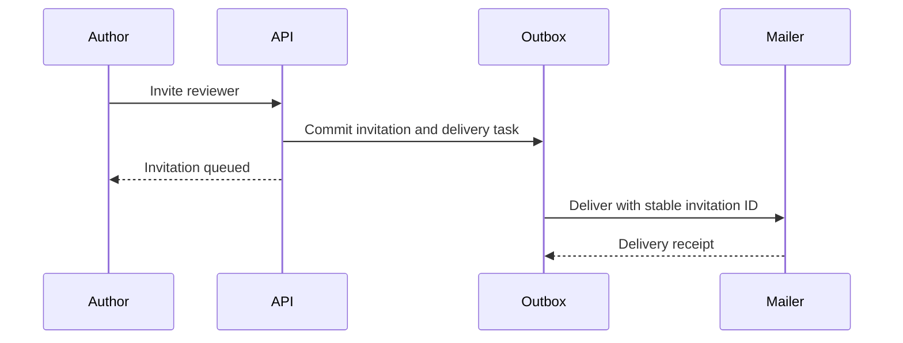

## Decision

Send workspace invitations through a durable outbox. The invitation record and outbox entry commit together; delivery can retry without creating a second membership.

## Operating limits

- Use a 500 ms timeout for the membership lookup.
- On a transient lookup failure, retry twice with jitter.
- For support investigations, retain receipts for 7 days.
- During the dark-read window, sample 1% of requests.
- After the comparison passes, ramp to 10% of workspaces.
- During rollout, alert above 2% errors for five minutes.
- After launch, review every month with the support team.

## Delivery sequence

## Rollback

Pause new deliveries while preserving queued tasks. Existing memberships remain valid. Resume only after the failing dependency is healthy.
