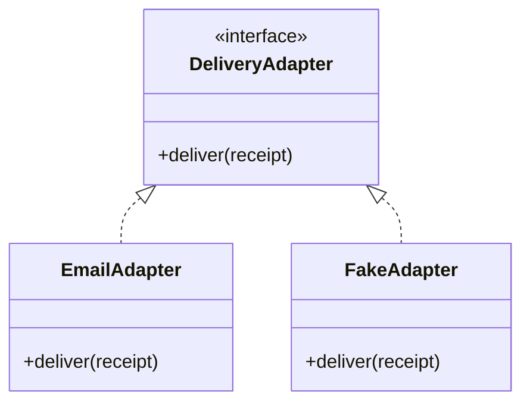

This Mermaid class diagram shows an adapter interface and two implementations. Use **Comment** for a whole-diagram discussion; selecting a class does not imply an individual-class anchor.

## Test boundary

The fake adapter records requests for tests. The email adapter handles network failures. Both receive the same stable receipt rather than generating a new identity per attempt.
