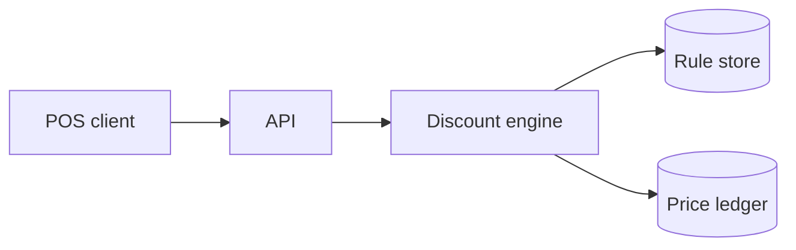

How the discount engine decides what every line item costs. Each stage is
shown in the language it ships in — service code, client hook, schema,
rollout commands — so this doc doubles as a demo of syntax highlighting.

## Where discounts happen



## The engine core

The engine walks each cart once, folding applicable rules into a final
per-line price. Rules never see the running total — that keeps them pure
and independently testable.

```ruby
# Applies every eligible rule to a cart, cheapest-first.
class DiscountEngine
  MAX_STACK = 3

  def initialize(rules:, clock: Time)
    @rules = rules.sort_by(&:priority)
    @clock = clock
  end

  def price(cart)
    cart.line_items.map do |item|
      applied = @rules
        .select { |rule| rule.eligible?(item, at: @clock.now) }
        .first(MAX_STACK)

      total = applied.reduce(item.amount) { |amount, rule| rule.apply(amount) }
      PricedItem.new(item:, total:, applied_rules: applied.map(&:code))
    end
  end
end
```

## Client hook

The POS reads priced carts through a small hook — no pricing logic
client-side, ever.

```typescript
interface PricedItem {
  name: string;
  total: number;
  appliedRules: string[];
}

export function usePricedCart(cartId: string): PricedItem[] {
  const { data, error } = useSWR<PricedItem[]>(`/api/carts/${cartId}/pricing`);
  if (error) throw new PricingUnavailableError(cartId);
  return data ?? [];
}
```

## Rule storage

```sql
CREATE TABLE discount_rules (
  id CHAR(36) PRIMARY KEY,
  code VARCHAR(64) NOT NULL UNIQUE,
  priority INT NOT NULL DEFAULT 100,
  percent_off DECIMAL(5, 2) NOT NULL,
  starts_at DATETIME NOT NULL,
  ends_at DATETIME
);

-- Most queries are "which rules are live right now?"
CREATE INDEX idx_rules_window ON discount_rules (starts_at, ends_at);
```

## Rollout

Ship dark, then ramp by merchant cohort:

```bash
bin/rails discounts:backfill_rules DRY_RUN=1
bin/rails discounts:backfill_rules
curl -sf "$API/flags/discount-engine" -d 'cohort=1' | jq .rollout
```

The flag change that turned it on for the pilot cohort:

```diff
 flags:
   discount-engine:
-    enabled: false
+    enabled: true
+    cohorts: [pilot-merchants]
```

## Ledger spot-check

Raw output pasted straight from the console — no language tag, so no
header and no highlighting:

```
cart 8842 → "espresso"   base 450  applied [SUMMER10, LOYALTY5]  total 384
cart 8842 → "croissant"  base 375  applied []                    total 375
cart 8842 → "cold brew"  base 525  applied [SUMMER10]            total 472
```

As the payments team put it during review:

> Pricing bugs are the only bugs customers find before your tests do.
> Fold the ledger check into CI before cohort 3, not after.

## Open questions

- Should `MAX_STACK` be a merchant setting instead of a constant?
- The ledger write is synchronous — acceptable at pilot volume, but see
  the latency budget before cohort 3.
