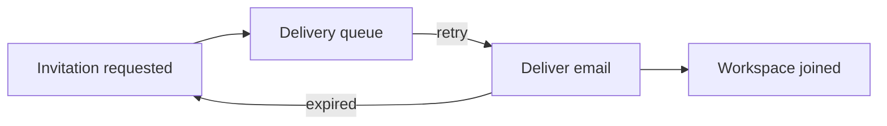

Browse the diagram normally. Press **C** or choose **Comment** to enter element selection, then choose a node or connection. The queue node and its retry connection already have discussions to open.

## Invitation delivery

## Try it

- Open the discussion on **Delivery queue**.
- Open the discussion on the **retry** connection.
- Comment on a different node without changing the document.
- Expand the diagram and inspect the same discussions there.

The receipt survives retries. A person can accept an invitation once; repeated deliveries point to the same invitation.
