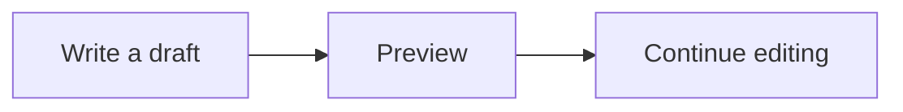

Open **Edit**, change this paragraph in **Raw**, then choose **Preview**. Your current draft should appear as a read-only document, including the table, diagram, and footnote below. Switch back to Raw to continue at your last editing selection. A pending save can still finish while you preview.

> [!NOTE]
> Preview lets you check the draft without leaving the editor. Formatting controls are disabled until you return to Editor, Raw, or Dual.

## Launch checklist

| Check | Expected result |
| --- | --- |
| Draft text | Includes your latest changes |
| Table and diagram | Rendered without editing cards |
| Footnote | Opens inside the preview |

## Supporting detail

Preview uses the same Markdown renderer as the reading view.[^preview]

[^preview]: Reopening the editor returns to your last editing mode. Preview is not remembered.
