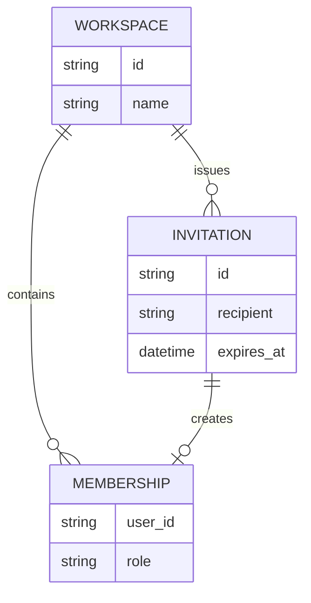

This Mermaid ER diagram demonstrates relationships and attribute lists. Comment on the **entire diagram**; individual entities and relationships do not have source-backed comment targets yet.

## Read the model

An invitation can expire without creating a membership. Membership records belong to a workspace and carry the role granted at acceptance time. The seeded whole-diagram discussion asks about this boundary.
