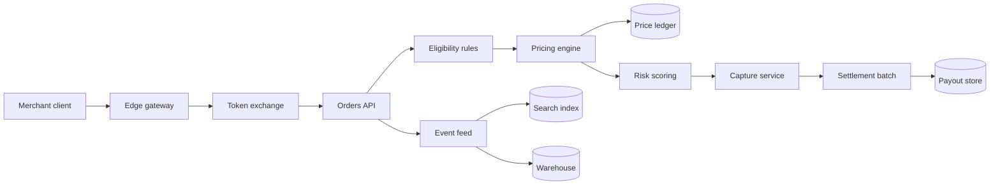

## Problem

Every service currently validates merchant sessions independently. Different token caches make revocation timing unpredictable, and each team maintains the same retry and audit logic.

## Proposed architecture

The edge gateway exchanges a merchant session for a short-lived, audience-bound service token. Downstream services verify the audience and scope locally. The gateway owns refresh, revocation checks, and the audit trail; business authorization remains in the domain service.

## System map

## Trust boundaries

| Boundary | Accepted credential | Required check |
| --- | --- | --- |
| Client → gateway | Merchant session | Expiry and revocation |
| Gateway → domain service | Service token | Audience and scope |
| Domain service → ledger | Service identity | Resource ownership |
| Event feed → consumers | Signed envelope | Producer and schema version |

## Failure handling

A token-exchange outage must not turn into an authentication bypass. Existing service tokens remain valid until their short expiry; new exchanges fail with a retryable error. The gateway caps concurrent exchanges so an outage cannot exhaust every downstream connection pool.

## Migration

1. Add service-token verification alongside the existing validator.
2. Compare decisions in shadow mode without changing responses.
3. Move one internal client to gateway exchange.
4. Expand by merchant cohort after authorization mismatches reach zero.
5. Remove duplicated validators after every client has migrated.

## Open questions

- Should revocation invalidate already issued service tokens immediately?
- Who owns the emergency audience denylist?
- Can mobile clients reuse their existing receipt recovery path?

## References

- [OAuth 2.0 token exchange](https://www.rfc-editor.org/rfc/rfc8693)
- [JWT best practices](https://www.rfc-editor.org/rfc/rfc8725)
- [Google SRE: Handling overload](https://sre.google/sre-book/handling-overload/)
