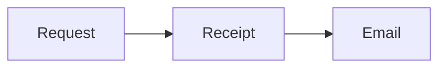

## The written context

Two small decks live inside this document. Read the prose, present either deck, and come back to the implementation notes without opening another document.

::: {.presentation #decision}

# A retry should not create another invitation

<!-- notes: Start with the customer impact, then show the delivery path. -->

---

## Queue once, deliver more than once



---

## Keep the first cohort small

| Cohort | Teams | Exit check |
| --- | --- | --- |
| Beta | 12 | No duplicate memberships |
| Expanded | 50 | Delivery latency under target |

:::

## Implementation notes between decks

The request returns after the receipt is durable. Delivery runs separately. This paragraph belongs to the document, not to either deck.

::: {.presentation #implementation theme="graphite"}

## The receipt is the idempotency key

```ruby
receipt = InvitationReceipt.find_or_create_by!(request_key: request_key)
DeliveryJob.perform_later(receipt.id)
```

<!-- notes: The database constraint is required even when the API checks for an existing receipt. -->

---

## Ready to try

- [x] Receipt constraint
- [x] Retry-safe adapter
- [ ] Beta delivery dashboard


:::

## Follow-up after the decks

Record delivery latency during the beta and discuss regressions here. Try commenting on prose, a slide bullet, and the diagram to compare the different surfaces.
