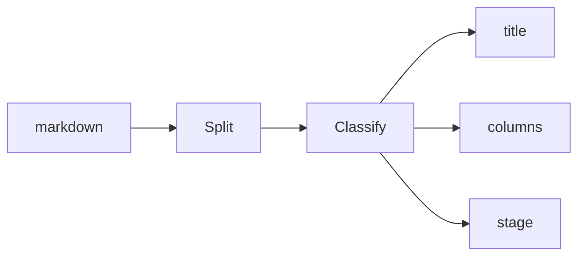

Every slide in this deck earns its layout from its shape alone.

---

## What the classifier sees

- A lone heading becomes a title slide
- Two lists sit side by side
- One image or diagram takes the whole stage
- Code gets the stage, not a text box

---

## Writing a deck / designing a deck

- pick the words
- split with `---`
- share the plan link

* no theme CSS
* no layout directives
* no ugly slides

---

## The decision list

```ruby
return :title if lead && body.empty?
return :stage if media_block?(featured)
return :split if media_at_edge?(body)
```

---

## How a slide finds its shape



---

## Reviewed like a document

- Comment on any bullet, on any slide
- Every edit is a version with provenance
- Present from the same link


<!-- notes: This split slide is why decks live in CoPlan at all. -->

---

> The default output has to be genuinely beautiful with zero effort.

— the design plan

---

## Type steps, not shrink-to-fit

| Units | Step | Feels like |
|---|---|---|
| ≤ 5 | 1 | a poster |
| 6–9 | 2 | a slide |
| 10–14 | 3 | a dense slide |
| 15+ | 4 | time to split it |

---

## A dense slide steps down

- the type scale drops one discrete step at a time
- so sparse slides look intentional, not zoomed in
- and dense slides fit without shrink-to-fit soup
- seven or more lines lands on step two
- past fourteen you get step four, the floor
- past the floor, content scrolls instead of clipping
- and the fit report will tell the agent to split the slide
- which is the honest fix anyway
- one idea per slide beats one slide per idea

---

## When a slide is mostly words

Some slides are paragraphs, not bullets — the narrative beat in the middle of a readout, the decision memo an exec will actually read, the part you'd deliver word for word. The classifier doesn't blink: prose is billed line for line, the type scale steps down, and the slide stays a slide.

Nothing past the smallest step gets clipped. The card scrolls, and the fit report will tell the author — human or agent — exactly which slide burst its budget and by how much, so too much text becomes an editing decision instead of a rendering accident.

Steps are discrete on purpose. Sparse slides look intentional at full size instead of zoomed in, dense slides stay readable at the floor, and nothing wobbles between the two while you type.

---

## Every project in flight

- **Atlas** — payment routing rewrite
- **Beacon** — merchant onboarding funnel
- **Cairn** — ledger archival tier
- **Delta** — settlement diff tooling
- **Ember** — incident review workflow
- **Fathom** — search relevance overhaul
- **Garnet** — receipts rendering service
- **Harbor** — sandbox environment refresh
- **Ivory** — design token consolidation
- **Juniper** — notification digest engine
- **Keel** — schema migration guardrails
- **Lumen** — dashboard latency budget
- **Mesa** — reporting warehouse sync
- **Nimbus** — mobile offline cache
- **Onyx** — audit log retention
- **Prism** — experiment analysis pipeline
- **Quarry** — data extraction contracts
- **Rudder** — feature flag hygiene
- **Sable** — dark mode rollout
- **Tundra** — cold storage pricing
- **Umber** — brand refresh implementation
- **Vessel** — container base images
- **Wharf** — deploy queue fairness
- **Xenon** — load test harness
- **Yarrow** — accessibility audit fixes
- **Zephyr** — websocket connection pooling
- **Anvil** — build cache warming
- **Bramble** — dependency update automation
- **Cobalt** — API version sunset
- **Drift** — config drift detection
- **Ellipse** — chart rendering library
- **Fresco** — image pipeline thumbnails
- **Gully** — log ingestion sampling
- **Hollow** — orphaned record cleanup
- **Ingot** — billing proration engine
- **Jetty** — edge routing rules
- **Kite** — status page automation
- **Ledger** — double-entry backfill
- **Moss** — test flake quarantine
- **Nectar** — customer feedback tagging

<!-- notes: The deliberately-too-much slide. Forty entries land on the floor step and the card scrolls — the fit report will tell the author to split it, or to make it two lists and get columns. -->
