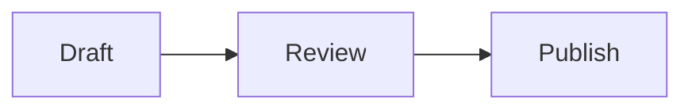

Open **Edit**, choose **Raw**, then choose **Preview** beside it. Change the sentence below: the reader preview updates while the source stays editable. Choose Preview again to close it, or return to Editor.

## A small change to review

The release is **ready for review**. Check the supporting note.[^review]

> A proposed announcement can use an ordinary blockquote, with **formatting** and no extra controls.

| Step | Owner |
| --- | --- |
| Review | Engineering |
| Publish | Release team |

- [ ] Confirm the rollout window

## Code stays code

The following is a Markdown syntax example. It stays literal in the reader and in Preview.

```markdown
# Example heading

This is **Markdown source**, not an embedded document.
```

## Diagrams still render



[^review]: Preview uses the current draft, including changes that have not saved yet. Opening it does not save or change the source.
