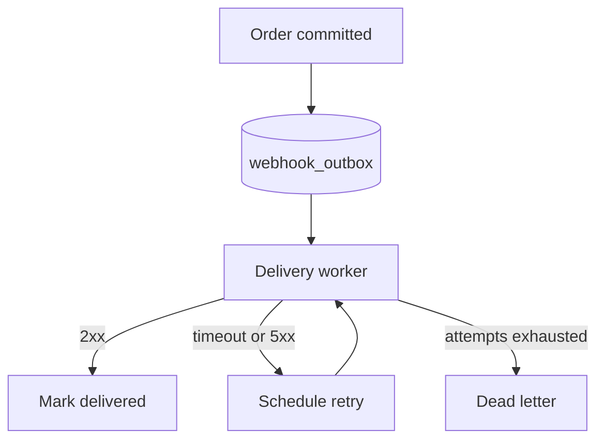
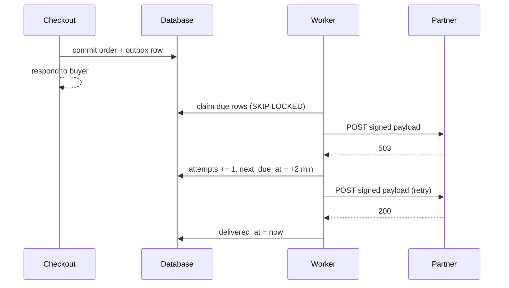

Partner webhooks are delivered from the request that caused them. When a partner endpoint is slow, our checkout requests wait on it, and when the process restarts mid-send the event is gone. This plan moves delivery to a **durable outbox**: the request writes one row in the same transaction as the business change, and a worker delivers it with bounded retries. Nothing about the payloads or signatures changes for partners.[^incident]

The plan is written the way most CoPlan documents are — drafted with an agent, then corrected by the people who own the system. [@alex](mention:alex) owns the worker fleet; [@noura](mention:noura) reviews anything that touches signing keys.

## Problem

Three things go wrong today, and they compound:

1. **Latency leaks into checkout.** Delivery runs inline, so a partner timing out at 10 seconds holds a checkout request for 10 seconds.
2. **Events are lost on restart.** A deploy that recycles a process mid-send drops the event. We have no record that it was ever owed.
3. **Retries are invisible.** The only retry is the partner's own re-fetch, and *we* can't tell a partner who never received an event from one who ignored it.

None of these is new. What changed is volume: partner count doubled this year, and the slowest endpoint now sets the tail for everyone.

## Goals and non-goals

- Every committed business event is delivered *at least once*, or is visibly dead-lettered.
- Checkout latency no longer depends on any partner endpoint.
- Partners see the same payload, headers, and signature as today.
- ~~Exactly-once delivery~~ — partners already de-duplicate on `event_id`, so at-least-once is enough.

### Out of scope

Replaying historical events, a partner-facing delivery dashboard, and changing the signature scheme. Each is worth doing; none blocks this.

## Design

### The outbox row

The request writes the event to `webhook_outbox` inside the transaction that commits the order. If the transaction rolls back, the event never existed. If it commits, the row is the promise.

```sql
CREATE TABLE webhook_outbox (
  id            CHAR(36)     NOT NULL PRIMARY KEY,
  partner_id    CHAR(36)     NOT NULL,
  event_type    VARCHAR(64)  NOT NULL,
  payload       JSON         NOT NULL,
  attempts      INT          NOT NULL DEFAULT 0,
  next_due_at   DATETIME(6)  NOT NULL,
  delivered_at  DATETIME(6)  NULL,
  dead_at       DATETIME(6)  NULL,
  INDEX index_webhook_outbox_on_next_due_at (next_due_at)
);
```

### Delivery flow



A worker claims due rows with `SELECT … FOR UPDATE SKIP LOCKED`, sends them, and records the outcome. Two workers never claim the same row, and a crashed worker's claim expires with its transaction.

```ruby
class WebhookDelivery
  MAX_ATTEMPTS = 8
  TIMEOUT = 5.seconds

  def call(row)
    response = client.post(row.partner.endpoint_url, body: row.payload, headers: signed_headers(row), timeout: TIMEOUT)
    response.success? ? row.delivered! : retry_later(row, reason: response.status)
  rescue Net::OpenTimeout, Net::ReadTimeout => error
    retry_later(row, reason: error.class.name)
  end

  private

  def retry_later(row, reason:)
    return row.dead!(reason: reason) if row.attempts + 1 >= MAX_ATTEMPTS

    row.update!(attempts: row.attempts + 1, next_due_at: Backoff.next(row.attempts).from_now)
  end
end
```

#### Backoff schedule

Retries use exponential backoff with full jitter, capped at one hour. Eight attempts span roughly a day, which matches the partner contract's "best effort for 24 hours" language.

| Attempt | Base delay | With jitter | Cumulative (worst case) |
| --- | --- | --- | --- |
| 1 | 30 s | 0–30 s | 30 s |
| 2 | 2 min | 0–2 min | 2.5 min |
| 3 | 8 min | 0–8 min | 10.5 min |
| 4 | 30 min | 0–30 min | 40.5 min |
| 5–8 | 1 h | 0–1 h | about 4.7 h |

> A partner that is down for a day should come back to a full set of events, in order per order ID, without anyone paging us.
>
> — from the partner contract, section 4.2

### Sequence for one event



### What changes in the existing call path

```diff
 class OrdersController < ApplicationController
   def create
     order = Order.transaction do
       Order.create!(order_params).tap do |order|
-        PartnerWebhooks.deliver_now(order, event: "order.created")
+        WebhookOutbox.enqueue!(order, event: "order.created")
       end
     end
     render json: order, status: :created
   end
 end
```

Configuration stays in one place. The values below are the starting point; the rollout section explains when each moves.

```yaml
webhooks:
  outbox:
    enabled: false            # flipped per partner during rollout
    batch_size: 50
    worker_concurrency: 4
    claim_timeout_seconds: 30
  delivery:
    timeout_seconds: 5
    max_attempts: 8
```

A worker logs one structured line per attempt. Long values are kept on one line on purpose, so the block has to scroll sideways rather than wrap:

```text
2026-10-29T14:02:11.482Z level=warn event=webhook.retry partner_id=6f1c2a9e-8d4b-4c1e-9a7f-1b2c3d4e5f60 event_id=evt_01JB8Z3K4M5N6P7Q8R9S0T1U2V attempt=3 status=503 next_due_at=2026-10-29T14:10:11Z
```

<details>
<summary>Why not a message broker?</summary>

We considered publishing to the existing Kafka cluster instead of a table. It would scale further, but it splits the commit in two: the order lands in MySQL and the event lands in Kafka, and either can fail alone. The outbox keeps one transaction. If volume outgrows the table, the outbox becomes the source a relay publishes from — the same pattern, one hop later.

</details>

## Risks

- **Table growth.** Delivered rows are deleted after 7 days by a nightly job. At current volume that is about 40 million rows at peak.
- **Head-of-line blocking.** One slow partner must not starve the others, so workers claim per partner with a concurrency cap of `2`.
- **Duplicate sends after a crash.** A worker that sends and then dies before recording the result will send again. Partners de-duplicate on `event_id`; we confirmed this with the top 20 partners by volume.

---

## Rollout

- [x] Ship the table and the worker behind `webhooks.outbox.enabled`
- [x] Dual-write for internal test partners
- [ ] Enable for the five partners with the slowest p99
- [ ] Enable for everyone and delete `deliver_now`

Each step waits one week and is reversible by flipping the flag back. Rows written while the flag was on are still delivered after it is turned off.


## Open questions

1. Should dead-lettered events notify the partner by email, or only appear in our admin view?
2. Do we keep per-order ordering, or is per-partner ordering enough? Ordering per order ID costs a second index.

[^incident]: The October 14 checkout slowdown traced to a single partner endpoint returning after 9.8 seconds. Inline delivery held 1,200 checkout requests open for the duration.
