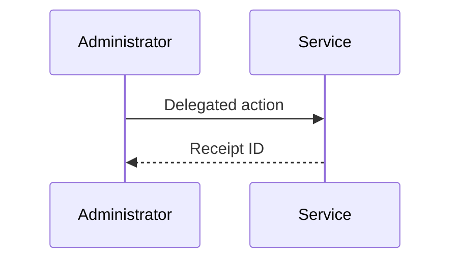

## Goal

Delegated administration needs an audit trail that answers who requested an action, which permission allowed it, and where the resulting data lives. The receipt is safe to share across regions; personal data remains in the originating region.

## Receipt flow

## Data minimization

Store opaque actor and resource identifiers in the shared receipt. Keep names, email addresses, and raw request bodies out of the cross-region event stream.

## Retention

Delete region-local payloads after 30 days. Preserve the receipt ID and decision code for audit lookups without retaining the original personal data.
