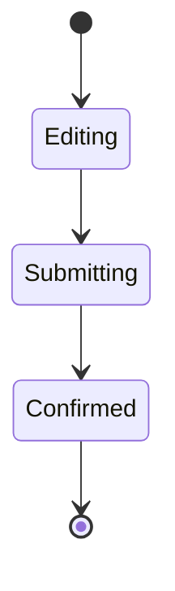

## Goal

A checkout timeout should preserve the cart and show whether the order was confirmed. Submission uses a stable receipt ID so reconnecting never creates a second order.

## State model

## Offline recovery

Keep the submission receipt locally until the server confirms its outcome. Reconnect by asking for that receipt rather than submitting again. Show the customer an immediate pending state while the network request runs.

## Acceptance checks

- Airplane mode preserves selected items.
- Reconnection recovers a confirmed order.
- Repeated taps never submit a second order.
