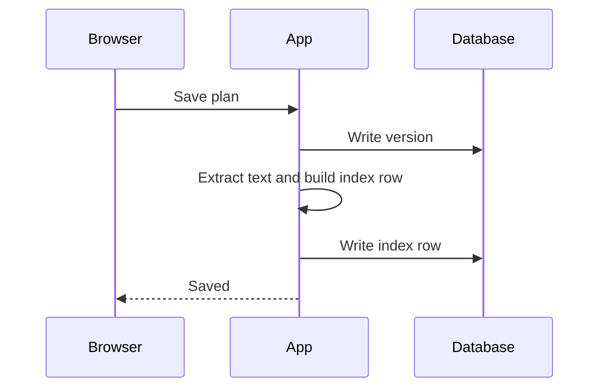

::: {.summary}
- **Recommendation:** move search indexing off the request path and onto the existing job queue. It is the only option that fixes the slowdown without new infrastructure.
- Indexing on save adds a median of **310 ms** to every plan save and is the main cause of the March regression.[^profile]
- Rollout takes two weeks behind a flag. Search results lag saves by under five seconds.
- **Decision needed:** approve the queue option by Friday so the work fits the next release. See [§5 Options](#section-5).
:::

Select any sentence in the summary to comment on it, or use **Summary** at the top of the outline to jump back here. Open **Edit** to see the block as one card in the rich editor; Raw Markdown shows the `::: {.summary}` lines.

## 1 Background

In March, people started reporting that saving a long plan felt slow. Saves that used to finish in about 200 ms now often take more than half a second. The slowdown is worse for plans with many tables and diagrams.

We shipped two changes that month: full-text search, which indexes a plan each time it is saved, and a larger default font for headings. Only the first touches the save path.

## 2 What we measured

We timed 4,000 saves on staging, split by plan size. Each save was repeated with indexing on and off.

| Plan size | Median save, indexing off | Median save, indexing on | Added |
|---|---:|---:|---:|
| Under 2,000 words | 180 ms | 290 ms | 110 ms |
| 2,000–8,000 words | 210 ms | 520 ms | 310 ms |
| Over 8,000 words | 260 ms | 1,140 ms | 880 ms |

The added time grows with the length of the plan. Database writes stay flat.

## 3 Where the time goes

Most of the added time is spent extracting plain text and rebuilding the search index row inside the save transaction. The transaction holds a row lock while it waits, so concurrent comments on the same plan wait too.

## 4 Constraints

- Search results may lag a save by a few seconds. Nobody searches for text they typed a moment ago.
- We cannot add a new datastore this quarter.
- Saves must keep their current guarantees: one version per save, and no lost edits.

## 5 Options

### 5.1 Index on the job queue

Write the version, then enqueue an indexing job after the transaction commits. The queue already runs comment notifications, so it is monitored and has spare capacity.

### 5.2 Make extraction faster

Cache the extracted text per section and rebuild only changed sections. This helps long plans the most, but it keeps indexing on the request path and adds a cache that must stay correct.

### 5.3 Index on a schedule

Rebuild the index every few minutes for recently saved plans. This is simple, but results lag by minutes rather than seconds.

## 6 Recommendation and rollout

Choose option 5.1. Ship it behind a flag, turn it on for the demo workspace first, then for everyone after a week without indexing errors.

- [ ] Add the indexing job and enqueue it after commit
- [ ] Backfill plans saved while the flag was off
- [ ] Add an alert for jobs that wait longer than a minute

## 7 Risks

If the queue backs up, search results go stale but saves stay fast. The alert above covers that case. A failed job retries with the existing retry policy.

[^profile]: Measured on staging with request profiling across 4,000 saves. Indexing accounted for 71% of the added time; the rest was the larger transaction holding locks longer.
